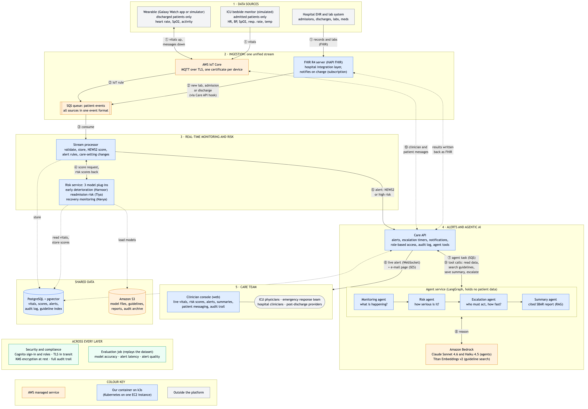

# Agentic AI platform for remote patient monitoring (ICU and post-discharge)

AMPBA capstone for Cloud Box Technologies. Patients are monitored in two settings: in the ICU through bedside
monitors, and at home after discharge through a wrist wearable. Readings stream in real time, deterministic rules
page the care team within a second, three risk models score each patient, and four AI agents add a cited clinical
summary and an escalation recommendation. Everything is exchanged with the hospital record over FHIR.

> **Every patient comes from the team's model-training data and from nowhere else**: 63 real MIMIC-IV-demo
> patients and 200 synthetic ones. The platform invents no patients. Their recorded readings are loaded as
> history; live readings are newly generated from each patient's last recorded values, never a replay of the
> files. See [Where the patients come from](docs/HLD.md#2-where-the-patients-come-from). The controls are designed as if it
> were live patient data.



The diagram source is [docs/architecture-simple.mmd](docs/architecture-simple.mmd). Follow the numbers ① to ⑩ to
trace one reading from a device to a clinician.

## Where to read next

| You want to | Read |
|---|---|
| Understand the design and how it covers the brief | [docs/HLD.md](docs/HLD.md) |
| Run it on your laptop | Quick start below, then [docs/e2e-test.md](docs/e2e-test.md) |
| Hand over a model (Harnoor, Tiya, Navya) | [models/CONTRACT.md](models/CONTRACT.md) |
| Connect a real Galaxy Watch | [docs/watch-setup.md](docs/watch-setup.md) |
| Operate or deploy it | [docs/runbook.md](docs/runbook.md) |
| Present it | [docs/demo-script.md](docs/demo-script.md) |
| See the measurements | [docs/evaluation-report.md](docs/evaluation-report.md) |
| Review security and compliance | [docs/security.md](docs/security.md) |

## Quick start (local)

You need Docker Desktop (4 GB is enough), [uv](https://docs.astral.sh/uv/), and the team's training data in a
folder named `Training Data/` in the repo root: `rpm_training_sample.csv` and `synthetic_wearable_stream_72h.csv`.
The folder is git-ignored and must never be committed.

```bash
make setup          # Python workspace
make up             # start the stack (add LLM=bedrock to use the Claude agents; see below)
make seed           # 30 of the training patients: registry, FHIR record, guideline index
make sim            # simulated ICU monitors and wearables
make e2e            # automated end-to-end check (about 4 minutes)
```

Then open the console at <http://localhost:3000> and sign in as **Demo lead**. Alert e-mails appear at
<http://localhost:8025>, the FHIR server at <http://localhost:8080>.

By default the agents run offline (deterministic rules and a templated summary) and alert e-mail stays in the
local inbox; neither needs credentials. After `aws login --profile rpm-capstone`:

- `make up LLM=bedrock` uses the real agents on Amazon Bedrock;
- `make up LLM=bedrock MAIL=ses` also sends alert e-mail to the care team's own mailboxes (see the
  [runbook](docs/runbook.md)).

By default 30 patients are monitored (6 shown in ICU, 24 at home). `RPM_COHORT_HOME=0 make seed sim` monitors all
263.

Useful while it runs:

```bash
make scenario P=RPM-10001725 S=sepsis RAMP=60     # make a patient deteriorate
make send P=SYN-000160 ARGS="--hr 134 --spo2 86"  # send one reading right now
make cohort                                     # who is monitored
make stats                                      # latency and counts
make logs                                       # follow the services
make down                                       # stop (make reset also deletes the data)
```

## On AWS

One CloudFormation stack in `ap-southeast-2`: IoT Core, SQS, one EC2 instance running k3s, Cognito, S3, ECR and
CloudFront. After `aws login --profile rpm-capstone`:

```bash
make cloud-up                                              # stack, images, containers, cohort (about 20 minutes the first time)
make cloud-user U=first.last E=<e-mail> G="physician presenter admin"   # a console account; the password arrives by e-mail
make cloud-status                                          # the console address and what is running
make cloud-e2e                                             # the same end-to-end check, against AWS
make sim-cloud ARGS="send --target SYN-000160 --event SOS" # a device event from your Mac
make cloud-stop                                            # stop the instance between demonstrations
```

The [runbook](docs/runbook.md) lists what is created, what it costs and how to delete it.

## Repository layout

```
services/stream-processor   consumes the patient-events queue: validate, store, NEWS2, alert rules, care-setting changes
services/risk-service       serves the three model plug-ins: builds features, scores, explains
services/care-api           alerts and escalation, notifications, sign-in and roles, audit, FHIR hook and write-back,
                            the tools the agents use
services/agent-service      four agents on Amazon Bedrock (LangGraph); holds no patient data
apps/console                clinician console (React)
libs/rpm_core               shared code: message contracts, NEWS2, alert rules, database, guideline index, and the
                            reader for the training data (the cohort)
simulator                   simulated ICU monitors and wearables; also the one-shot "send" command
edge/android                Wear OS watch app (and an optional phone companion)
models/plugins              the three models, each a self-contained plug-in; models/CONTRACT.md is the hand-over spec
tools/seed                  loads the training patients into FHIR, the registry and the guideline index
tools/eval                  evaluation: alert quality by replay, latency, agent audit
tools/iot-rule-emulator     local stand-in for the AWS IoT topic rule
deploy/k8s                  Kubernetes manifests for the AWS instance (k3s)
infra/cloudformation        the AWS resources, one stack
infra/scripts               cloud.sh (make cloud-*), node-apply.sh (runs on the instance)
contracts                   JSON Schemas for every device message
knowledge/protocols         the clinical protocols the summaries cite (demo content)
deploy/compose              the local stack
```

One image (`deploy/docker/python.Dockerfile`) holds every Python service; each container runs its own entry point.

## The team's models

All three are LightGBM models served from `models/plugins/<name>/1.0.0/` (model file, feature builder, metadata,
model card). Their hand-over folders are git-ignored; only what serving needs is committed.

| Model | Owner | Runs for | Evidence | On the platform |
|---|---|---|---|---|
| Recovery monitoring | Navya | patients at home | held-out AUROC 0.91; the platform rebuilds her inputs exactly | validated: a high score can raise an alert |
| Readmission risk | Tiya | patients at home with a hospital record | held-out AUROC 0.97, but 3 readmissions in the test set; the platform rebuilds her inputs exactly | not validated: shown as weak evidence |
| Early deterioration (6 h) | Harnoor | patients at home with a hospital record | his report: AUROC 0.92 on a file not in the hand-over; on the shared data 0.51, and 0.75 through the platform's features | not validated: shown as weak evidence |

`make model-check` checks every plug-in against [models/CONTRACT.md](models/CONTRACT.md) and that the platform builds
the same inputs each model was trained on. The model cards explain the limits.
