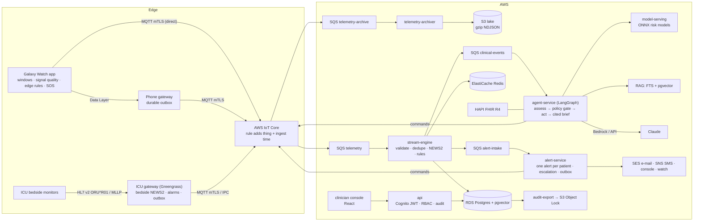
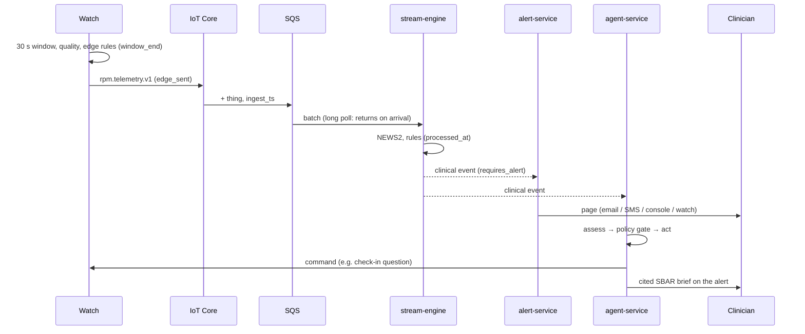

# High-level design: agentic AI remote patient monitoring (ICU and post-discharge)

Cloud Box Technologies · ISB AMPBA capstone. This document describes the system as built. Decisions and their
alternatives are in [adr/](adr); the build plan and progress are in [PLAN.md](PLAN.md). Measured behaviour is in
[evaluation-report.md](evaluation-report.md), and security in [security/](security).

## 1. What the system does

Patients are monitored in two settings:

- **After discharge:** at home, wearing a Samsung Galaxy Watch paired with a phone.
- **In ICU:** through bedside monitors feeding a gateway.

Vitals stream in real time to AWS, where deterministic clinical rules decide within about a second whether a care
team must be paged. Claude-based agents then assess the situation and act within strict policy. They can request a
spot check, ask the patient a question on the watch, sample faster, or escalate. They also write an
evidence-cited SBAR brief for the clinician. Everything is recorded in FHIR, and every access to patient data is
audited.

Design principles:

1. **Rules page; agents assist.** The safety net never depends on the LLM (ADR 0001).
2. **No patient identifiers on the wire or at the edge.** Devices know only their own identity; the mapping to
   patients lives server-side (ADR 0005).
3. **Everything measurable.** Latency is stamped at every hop, and alert quality is proven by replay against
   ground truth.

## 2. Architecture

## 3. Components

| Component | Responsibility | Key properties | Code |
|---|---|---|---|
| Watch app | Sensor windows (30/15/5 s by profile), signal quality, on-device rules and haptics, SOS, check-ins | Samsung SDK, Health Services or scripted sources; works offline | `edge/android/wear` |
| Phone gateway | IoT identity, durable outbox, relays commands to the watch | SQLite outbox, mTLS | `edge/android/phone` |
| ICU gateway | HL7 v2 to canonical telemetry, bedside NEWS2 and alarms, store-and-forward | Relays for registered beds only; drops PID segments; retained per-bed config from the cloud | `edge/icu-gateway` |
| IoT Core + rule | Device authentication, topic authorisation, fan-out to the ingest queue and the archive queue | Topic is authoritative (`topic(4)` becomes the thing) | `infra/terraform/aws/iot.tf` |
| stream-engine | Validates, de-duplicates, resolves device to patient, scores NEWS2, runs rules, persists, emits clinical events | Exactly-once effects; per-patient NEWS2 baseline, activity context and persistence | `services/stream-engine`, `libs/rpm_features` |
| alert-service | Opens or updates one alert per patient; pages the tier for its severity; timed escalation and reminders | Postgres timers (`SKIP LOCKED`), transactional outbox, pages coalesced per burst | `services/alert-service`, `libs/rpm_alerts` |
| agent-service | Assess, apply the policy gate, act (device commands, escalate), then write a cited SBAR brief | Claude on Bedrock or the API; offline fallback; one run per burst | `services/agent-service` |
| model-serving | Risk models as ONNX packages with explanations, published as FHIR RiskAssessment | Plug-in contract for the data team's models; `validated` flag | `services/model-serving` (ADR 0009) |
| RAG | Protocols plus per-patient summaries; hybrid retrieval; citation checking | Stable citable chunk ids | `libs/rpm_rag` (ADR 0010) |
| api + console | Worklist, patient view, briefs with evidence, actions, presenter controls | Cognito PKCE, RBAC, audit, `no-store` responses | `services/api`, `apps/clinician-console` |
| audit-export | `audit_log` to FHIR AuditEvent, hash-chained, in WORM storage | Hourly CronJob | `services/api/src/rpm_api/audit_export.py` |

## 4. How a reading flows (the latency path)

Measured locally at p95 (evaluation report §2):

| Path | p95 |
|---|---|
| Sensor window → scored, home | about 1.0 s |
| Sensor window → scored, ICU | about 1.4 s |
| Sensor window → page | about 1.9 s |

The dominant hop is the stream engine's 1 s Kinesis poll.

## 5. Deployment

| | Local (development and evaluation) | AWS demo (`make cloud-up`) |
|---|---|---|
| Devices | Wear OS emulator or Galaxy Watch; 149-device simulator | Same simulator (in EKS); watch provisioned with an IoT certificate |
| Ingest | Mosquitto (plain, plus mTLS on 8883), rule emulator, ElasticMQ, archiver to `data/lake` | IoT Core, IoT rule, two SQS queues, archiver to S3 |
| Compute | docker compose | EKS 1.33 on Graviton (arm64) managed nodes (ADR 0006); ICU gateway as a pod or on a Greengrass core (t4g.small) |
| Data | Postgres + pgvector, Redis, HAPI FHIR, ElasticMQ | RDS Postgres, ElastiCache, HAPI FHIR on EKS, SQS |
| Identity | API-minted dev tokens (same verification path) | Cognito user pool, IoT X.509, EKS Pod Identity |
| Observability | Prometheus + Grafana (`make obs`) | kube-prometheus-stack (`OBSERVABILITY=1`), CloudWatch |
| Audit | `audit_log` and local export | Hourly export and CloudTrail to an S3 Object Lock bucket |

All infrastructure is code: Terraform (`infra/terraform`), a Helm chart (`deploy/helm/rpm`) and compose
(`deploy/compose`). `cloud-up` builds everything from scratch; `cloud-down` removes everything except the state
bucket.

## 6. Non-functional requirements

| NFR | Target | How it is met | Evidence |
|---|---|---|---|
| Alert latency | Sensor → page p95 < 5 s | Deterministic rules on the stream; alert outbox; 0.25 s coalescing | Grafana; evaluation §2 |
| Alert quality | < 1 alert per patient-day at home, with sensitivity kept | Activity context, personal NEWS2 baseline, persistence, one alert per patient | Replay: 0.66 per patient-day, 35/36 (evaluation §1) |
| Availability of the safety net | Pages without the LLM | Rules path independent of agents; SQS retention | Chaos `agent-down` |
| No data loss | Zero loss through network, broker or consumer outages | Edge outboxes, QoS 1, SQS redelivery with dead-letter queues, dedupe on `msg_id` | Chaos `broker-outage`, `stream-engine-kill`, `archiver-kill` |
| Security and privacy | HIPAA- and GDPR-aligned | mTLS, KMS everywhere, Cognito + RBAC, NetworkPolicies, WORM audit | `security/` |
| Scalability | 10k devices (AWS) | SQS (no shard limit), parallel batched receives, one consumer with Redis state, IoT Core | Load test (evaluation §4) |
| Cost | Demo ≤ about US$10/day, torn down after use | Graviton, single NAT, on-demand EKS, budget alarm | `security.tf` budget |

## 7. Key decisions

| ADR | Decision |
|---|---|
| [0001](adr/0001-deterministic-safety-net.md) | Rules page; the LLM never gates an alert |
| [0002](adr/0002-event-bus-and-consumer.md) | *(superseded by 0014)* Kinesis with a custom consumer; SQS for work queues |
| [0003](adr/0003-local-emulators.md) | Open-source local emulators instead of LocalStack |
| [0004](adr/0004-news2-for-wearables.md) | NEWS2, including partial scoring for wearables |
| [0005](adr/0005-device-identity-and-phi.md) | One thing per device; topic is authoritative; no PHI on the wire |
| [0006](adr/0006-graviton-nodes.md) | Graviton (arm64) nodes |
| [0007](adr/0007-agents-and-llm.md) | LangGraph agents, Claude on Bedrock or the API, per-route effort |
| [0008](adr/0008-escalation-on-postgres.md) | Escalation timers on Postgres (not Step Functions) |
| [0009](adr/0009-model-plugin-contract.md) | ONNX model package contract for the data team |
| [0010](adr/0010-rag-design.md) | Hybrid retrieval with citable chunks |
| [0011](adr/0011-edge-gateways-and-provisioning.md) | ICU gateway relay identity, retained bed config, provisioning |
| [0012](adr/0012-authentication-and-rbac.md) | Cognito + API-side RBAC; dev tokens only locally |
| [0013](adr/0013-alert-quality.md) | Context-aware rules tuned by deterministic replay |
