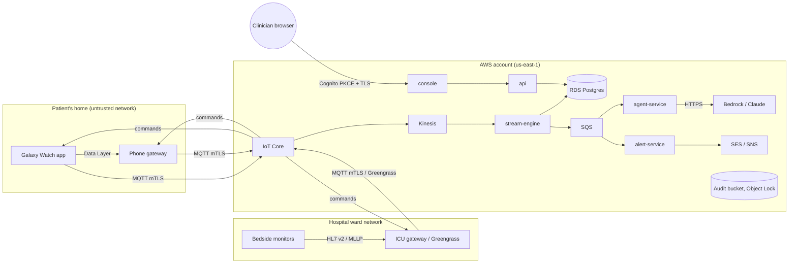

# Threat model (STRIDE)

Scope: the RPM platform as built. It covers the Galaxy Watch and phone app, the ICU bedside gateway, AWS IoT Core,
the streaming pipeline, the agents (Claude), alerting, the clinician console and API, and the AWS account. The data is
synthetic, but every control below is implemented as if it were real PHI.

Each mitigation names where it lives. A mitigation is either implemented (**✓**, with a pointer to code or
configuration) or a stated residual risk.

## Data flows and trust boundaries

Trust boundaries:

- **TB1:** devices to IoT Core, over the internet.
- **TB2:** bedside monitors to the gateway, on the hospital LAN.
- **TB3:** the clinician's browser to the console and API.
- **TB4:** agent-service to the model provider.
- **TB5:** operators to the AWS control plane.

## Findings

| # | Threat (STRIDE) | Where | Mitigation | Status |
|---|---|---|---|---|
| S1 | **Spoofing:** a device impersonates another patient's device | TB1 | One X.509 identity per thing, mutual TLS. The IoT policy binds the client id and topics to `${iot:Connection.Thing.ThingName}`. The stream engine trusts the topic, not the payload (`device_mismatch`). | ✓ `iot.tf`, `processor.py`, verified locally with a mirrored broker (ADR 0011) |
| S2 | **Spoofing:** the ICU gateway publishes for a bed it does not serve | TB1 | `device_assignments.gateway_id`: a relayed `device_id` is accepted only from its registered gateway. | ✓ `processor._relayed_by`, test |
| S3 | **Spoofing:** a user calls the API as someone else | TB3 | Cognito access tokens. The API checks RS256 signature via JWKS, issuer, expiry, `token_use=access` and `client_id`. `alg=none`, forged keys, ID tokens and other apps' tokens are rejected. The client-supplied `X-User` header was removed. | ✓ `rpm_api/auth.py`, 14 tests |
| S4 | **Spoofing:** dev tokens used in the cloud | API | `RPM_AUTH_MODE=dev` refuses to start unless `RPM_ENV=local`. The dev token endpoint does not exist in OIDC mode. | ✓ `configure_auth`, test |
| S5 | **Spoofing:** a rogue HL7 sender on the ward LAN | TB2 | MLLP has no authentication (a property of HL7 v2). Unknown or malformed monitor ids are NACKed, and the optional allow-list restricts beds. The Greengrass security group allows 2575 only from inside the VPC. | Partial. Residual: on a real ward, isolate monitors on a VLAN, or use MLLP over TLS where monitors support it. |
| T1 | **Tampering:** telemetry modified in transit | TB1 | TLS 1.2+ with mTLS end to end. Kinesis, SQS and S3 are encrypted with KMS, and S3 buckets deny non-TLS access. | ✓ |
| T2 | **Tampering:** audit records altered or deleted | DB, S3 | `audit_log` is append-only (a trigger rejects UPDATE, DELETE and TRUNCATE). Hourly export writes hash-chained FHIR AuditEvent batches to an S3 Object Lock bucket. CloudTrail has log-file validation. | ✓ `0005_audit_hardening.sql`, `audit_export.py`, `audit.tf` |
| T3 | **Tampering:** prompt injection alters agent behaviour | TB4 | Agent inputs are structured vitals and clinician-authored or deterministic documents; there is no free text from patients (check-ins are Yes/No). The policy gate decides actions: the LLM can raise severity but never lower it, patient-facing actions are blocked in ICU and on suspect data, and repeats are limited. Citations are checked against retrieved chunks. | ✓ `agent_service/policy.py`, `check_citations`. Residual: future free-text inputs would need an injection filter. |
| T4 | **Tampering:** a forged command sent to a watch | TB1 | Devices subscribe only to their own `cmd` topic. Only IAM roles (api, agent-service, alert-service) may publish `rpm/v1/dev/*/cmd`. Commands carry `issued_by` and an expiry, and expired commands are ignored. | ✓ `iam.tf`, `EdgePipeline.onCommand` |
| R1 | **Repudiation:** a clinician denies acknowledging or reading | API | Every PHI read and action is logged with the verified username, role, token subject and source IP. Records are immutable and exported to WORM storage. | ✓ |
| R2 | **Repudiation:** an operator denies an infrastructure change | TB5 | CloudTrail (management events, and S3 data events on the data and lake buckets) goes to the Object Lock bucket, KMS-encrypted and validated. | ✓ `audit.tf` |
| I1 | **Information disclosure:** PHI on the wire or in the IoT layer | TB1 | No patient identifiers in topics or payloads; device-to-patient mapping exists only server-side. The gateway drops HL7 PID segments. | ✓ ADR 0005, `gateway.py` |
| I2 | **Information disclosure:** PHI in notifications | SES/SNS | Minimum necessary: initials, the last 4 characters of the id, severity and a console link. No vitals or diagnoses. | ✓ `rpm_alerts/notify.py` |
| I3 | **Information disclosure:** PHI cached by browsers or proxies | TB3 | API responses carry `Cache-Control: no-store` and `Pragma: no-cache`. CSP limits `connect-src` to the console's own origin and Cognito. Tokens are kept in `sessionStorage`, never in URLs; the WebSocket token travels in the subprotocol header. | ✓ `main.no_store`, nginx template |
| I4 | **Information disclosure:** a presenter or admin sees more than needed | API | RBAC: presenter can run demo scenarios only (no PHI); admin can read but not act; nurse and physician can read and act. Enforced in the API; the UI only mirrors it. | ✓ `auth.PERMISSIONS`, tests |
| I5 | **Information disclosure:** device keys leak | Build | `.secrets/` is git-ignored and now excluded from Docker build contexts. Keys are pushed to devices with mode 0600 into the app sandbox. The Greengrass identity is delivered through Secrets Manager with KMS. | ✓. Residual: demo keys are generated by AWS (production: fleet provisioning by claim, key generated in the device's keystore). |
| I6 | **Information disclosure:** PHI sent to the model provider | TB4 | Bedrock keeps data in the account and region and does not use it for training. The prompt holds only the context the task needs. | ✓ ADR 0007 |
| D1 | **Denial of service:** device flood or a noisy thing | TB1 | IoT Core per-connection limits; the simulator fleet certificate is scoped to `sim-*` topics. Stream engine: batch processing, dedupe, backpressure through Kinesis. | ✓. Residual: add IoT Device Defender rules for rate anomalies. |
| D2 | **Denial of service:** the LLM or Bedrock is unavailable | TB4 | The deterministic safety net pages with no agent involved. Agent runs are debounced and coalesced per burst, with an offline fallback. | ✓ chaos experiment `agent-down` |
| D3 | **Denial of service:** the cloud link is lost at the edge | TB1, TB2 | Watch: in-memory outbox (5,000 items). Phone and gateway: durable SQLite outboxes. Bedside alarms keep working offline. | ✓ chaos experiment `broker-outage` |
| D4 | **Denial of service:** alarm fatigue making real alerts ignorable | Clinical | One active alert per patient; per-burst page coalescing; context-aware rules (activity, personal NEWS2 baseline, persistence). Measured by replay. | ✓ `docs/evaluation-report.md` |
| E1 | **Elevation of privilege:** pod compromise spreads laterally | EKS | One IAM role per workload through Pod Identity. NetworkPolicies deny ingress by default with an explicit allow-list. Pod security: non-root, read-only root filesystem, all capabilities dropped, seccomp. | ✓ `iam.tf`, `networkpolicies.yaml`, `values.yaml` |
| E2 | **Elevation of privilege:** a clinician widens their own role | Cognito | Admin-created users only (no self sign-up). Roles are Cognito groups managed by admins. Unknown groups grant nothing. | ✓ `cognito.tf`, test |
| E3 | **Elevation of privilege:** agent actions beyond policy | Agents | Tool actions go through `policy.gate`: an allow-list per care setting, repeat limits, and no severity downgrade. Every action is recorded on the alert timeline. | ✓ tests |

## Residual risks

- **HL7 MLLP is unauthenticated (S5).** Mitigate with network segmentation on real wards. The HL7 v2 standard offers no in-protocol authentication.
- **Demo key provisioning (I5).** Production should use fleet provisioning by claim, with a StrongBox or Keystore key on the device.
- **Console exposure.** The demo reaches the console over `kubectl port-forward` only, so there is no public ingress, and WAF therefore does not apply. A public deployment needs an ALB, WAF managed rules, and a hosted callback URL added to `console_urls`.
- **MFA is optional.** The Cognito pool supports TOTP; set `mfa_configuration = "ON"` for production.
- **Audit retention.** The demo uses GOVERNANCE mode for 7 days so the environment can be torn down. Production needs COMPLIANCE mode for 6 years (`audit_lock_mode`, `audit_retention_days`).
